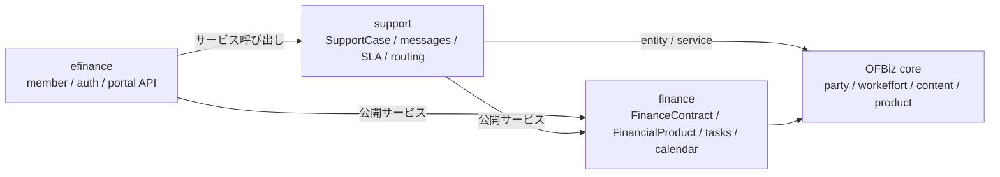

# Apache OFBiz Support 仕様書

`REQUIREMENTS_SUPPORT.md` の要件に対する設計。各 STEP の実装後に「実装」「テスト」「検証」を追記する。

> **状態：S0/S1/S2/S3/S4 実装済み、S5 以降は設計（未着手）**。2026-10-20 作成。プラグインの実装を始めるまで、本書と `REQUIREMENTS_SUPPORT.md` は `plugins/support/` に置く。実装後も同じ場所を正とする。

## 進捗

| STEP | 内容 | 状態 |
|------|------|------|
| S0 | 基盤（2 章） | 実装済み（2026-10-20） |
| S1 | ケース管理（3 章） | 実装済み（2026-10-20） |
| S2 | メッセージ・スレッド・自動起票（4 章） | 実装済み（2026-10-20） |
| S3 | 自動割当・SLA・エスカレーション（5 章） | 実装済み（2026-10-20） |
| S4 | 顧客ポータル API（6 章） | 実装済み（2026-10-20） |
| S5 | レポート・分析（7 章） | 設計（未着手） |
| S6 | 監査・保存・運用・テスト（9〜12 章） | 設計（未着手） |

### 実装・テスト・検証（2026-10-20）

- **S0**：`plugins/support` のプラグイン骨格、`ofbiz-component.xml`、entity model、seed、権限、スタッフ Web アプリ（`/support`）、設定、テストスイートを作成した。
- **S1**：`SupportCase` / `SupportCaseStatus` / `SupportCaseCommEvent` / `SupportCaseWorkEffort` / `SupportSla` / `SupportQueue` / `SupportQueueMember` / `SupportQueueProduct` と、作成・更新・割当・状態遷移・照会サービス、スタッフ画面（一覧・詳細・作成・編集）を実装した。
- **S2**：`addSupportCaseMessage` / `addSupportCaseInternalNote` / `replySupportCase` / `getSupportCaseThread` / `routeInboundSupportCommunication` / `linkOrphanInboundSupportEmails`、受信メールの ECA（`createCommunicationEvent` commit）、件名トークン、自動受付返信、ケース詳細のスレッド表示・返信・内部メモを実装した。
- **S3**：`SupportQueueProduct` によるキューの決定、`SupportQueueMember` の最少負荷割当、`SupportSla` の選択、`SupportSlaCalculator` による営業時間の期限計算、`support.sla.pauseOnPending` の停止・再開、`escalateOverdueSupportCases` による期限超過の検知・エスカレーション・タスク作成を実装した。
- **S4**：`createSupportCaseForCustomer` / `listSupportCasesForCustomer` / `getSupportCaseForCustomer` / `replySupportCaseFromCustomer` / `closeSupportCaseByCustomer` / `rateSupportCase` / `getSupportCaseFormOptions` / `uploadSupportAttachment` と `supportApiPermission` を実装した。顧客の所有確認、内部メモの非公開、`externalId` の冪等性、`api/support.rest.xml`（`publish="false"`）を追加した。
- **テスト**：`.\gradlew.bat compileJava compileGroovy` 成功。`.\gradlew.bat "ofbiz --load-data readers=seed --load-data component=support"` で seed 76 行を投入。`.\gradlew.bat "ofbiz --test component=support"` は 34 テスト、`errors="0"` / `failures="0"`。
- **画面**：`/support/control/main`、`FindSupportCase`、`EditSupportCase`、`createSupportCase` → `ViewSupportCase`、内部メモ・返信・スレッド表示の描画を確認した。キュー・SLA の値はケース詳細に表示される。
- **未実装**：S5 以降（レポート・監査/保存）。顧客向け REST の公開は efinance の認証完成後。エスカレーションのメール通知とジョブスケジューラの登録は運用設定で追加する。

---

## 1. 構成

### 1.1 プラグイン

| 項目 | 内容 |
|------|------|
| プラグイン | `plugins/support`（コンポーネント名 `support`） |
| 画面 | スタッフ向けのみ。マウント `/support`、base-permission `OFBTOOLS,SUPPORT` |
| パッケージ | `org.apache.ofbiz.support.casemgmt`（ケース）、`org.apache.ofbiz.support.message`（メッセージ・スレッド）、`org.apache.ofbiz.support.routing`（キュー・割当）、`org.apache.ofbiz.support.sla`（SLA）、`org.apache.ofbiz.support.api`（顧客 API）、`org.apache.ofbiz.support.report`（集計） |
| 依存 | **support → finance**、core（party / workeffort / content / product）。**finance は support を参照しない**。**efinance → support + finance**（将来） |
| データ | `data/SupportTypeData.xml`（seed：状態・種別・経路・解決コード・権限）、`data/SupportDemoData.xml`（demo：キュー・担当者・サンプル）、`testdef/data/SupportTestData.xml`（テスト専用） |
| API | サービス API を正とする。`api/support.rest.xml` は契約の定義用（既定 `publish="false"`）。顧客向けの公開は efinance の認証・`EfAccessGuard` と同時に行う |
| 文書 | 要件 `REQUIREMENTS_SUPPORT.md`、仕様 `SPEC_SUPPORT.md`（本書） |

### 1.2 依存関係



依存の向き（`A --> B` は A が B に依存する）。`finance` から `support` / `efinance` への依存はない。

- `plugins/support/ofbiz-component.xml` に `<depends-on component-name="finance"/>` を宣言する（finance の entity・サービスを利用するため）。
- `finance` は `support` の entity・サービス・画面を参照しない。
- `efinance` は `support` のサービスを `dispatcher.runSync` で呼ぶ。顧客の認証・所有確認は efinance が行い、support は受け取った `customerPartyId` とケースの顧客の一致を再確認する。

### 1.3 既存資産の再利用

| 既存 | 用途 |
|------|------|
| `CommunicationEvent` | メール・電話・FAX・手紙・Web・社内メモの本体。件名・本文・添付・from/to・`messageId`・`parentCommEventId`・`origCommEventId`・`headerString` |
| `storeIncomingEmail` | 受信メールの取込。送信者の名寄せ、`In-Reply-To` からの親メッセージ特定、添付の保存 |
| `sendCommEventAsEmail` / `sendEmailDated` | メール送信。`COM_IN_PROGRESS` のイベントを定期ジョブで送信 |
| `CommEventContentAssoc` / `Content` | 添付ファイル |
| `WorkEffort` | 対応タスク。`WorkEffortPartyAssignment`・`WorkEffortStatus`・`WorkEffortNote` |
| `FinanceContract` / `FinancialProduct` | 契約・商品との紐付け。`FinancialProduct` は core `Product` の 1:1 拡張 |
| `createFinanceContractTask` | 契約に紐付くタスク（`FINWE_OTHER`、`triggerKey` で冪等） |
| `BusinessDayCalculator` / `BusinessCalendar` | SLA の営業日計算。時間単位 SLA は support で補う |
| `TechDataCalendar` | 休日・営業日の定義 |
| `StatusItem` / `StatusValidChange` / `Enumeration` | 状態・種別・遷移 |
| `EmailTemplateSetting` / `sendMailFromTemplateSetting` | 通知の文面 |
| `Party` / `PartyNameView` / `PartyContactMech` | 顧客・担当者・連絡先 |

core の `CustRequest`（`RF_SUPPORT`）は使わない。ordermgr の顧客依頼で、契約への直接リンク・案件単位のスレッド・SLA がなく、金融商品・契約のサポートには足りないため、support の `SupportCase` を正とする。

### 1.4 関連文書

| 文書 | 内容 |
|------|------|
| `plugins/finance/SPEC_EFINANCE.md` | efinance の W6（マイページ・メッセージ・手続き）。support の顧客 API はここから呼ぶ |
| `plugins/finance/SPEC_COMMON.md` | finance 共通層（契約・タスク・営業日カレンダー） |
| `plugins/finance/REQUIREMENTS.md` / `REQUIREMENTS_LEASE.md` | ローン・リースの要件 |
| `plugins/finance/AGENTS.md` | finance の層・依存の規則 |

---

## 2. STEP S0 — 基盤

### 2.1 ディレクトリ

```text
plugins/support/
  build.gradle
  ofbiz-component.xml
  AGENTS.md                       … 実装後、finance の AGENTS に倣って追加（任意）
  REQUIREMENTS_SUPPORT.md
  SPEC_SUPPORT.md
  config/SupportUiLabels.xml
  config/support.properties
  entitydef/entitymodel.xml
  servicedef/services.xml
  servicedef/secas.xml
  data/SupportTypeData.xml
  data/SupportDemoData.xml
  widget/CommonScreens.xml
  widget/SupportMenus.xml
  widget/SupportScreens.xml
  widget/SupportForms.xml
  webapp/support/WEB-INF/web.xml
  webapp/support/WEB-INF/controller.xml
  webapp/support/error/
  template/support/
  api/support.rest.xml
  src/main/groovy/org/apache/ofbiz/support/…
  testdef/supporttests.xml
  testdef/data/SupportTestData.xml
```

プラグインの骨格は `.\gradlew.bat createPlugin -PpluginId=support -PwebappName=support "-PbasePermission=OFBTOOLS,SUPPORT"` で生成し、上記を追加する。`plugins` 配下は自動検出されるため `settings.gradle` の変更は不要。

### 2.2 `ofbiz-component.xml`

```xml
<ofbiz-component name="support" enabled="true">
    <depends-on component-name="finance"/>
    <resource-loader name="main" type="component"/>
    <classpath type="dir" location="config"/>

    <entity-resource type="model" reader-name="main" loader="main" location="entitydef/entitymodel.xml"/>
    <entity-resource type="data" reader-name="seed" loader="main" location="data/SupportTypeData.xml"/>
    <entity-resource type="data" reader-name="demo" loader="main" location="data/SupportDemoData.xml"/>

    <service-resource type="model" loader="main" location="servicedef/services.xml"/>
    <service-resource type="model" loader="main" location="servicedef/secas.xml"/>

    <test-suite loader="main" location="testdef/supporttests.xml"/>

    <webapp name="support" title="Support" server="default-server"
            location="webapp/support" base-permission="OFBTOOLS,SUPPORT"
            mount-point="/support"/>
</ofbiz-component>
```

### 2.3 権限

| 権限 | 内容 |
|------|------|
| `SUPPORT_AGENT` | ケースの閲覧・返信・内部メモ・状態変更・タスク作成 |
| `SUPPORT_MANAGER` | エージェントの権限＋再割当・キュー管理・レポート |
| `SUPPORT_ADMIN` | すべて＋SLA・設定・権限の管理 |
| `SUPPORT_API` / `SUPPORT_API_VIEW` / `SUPPORT_API_CREATE` / `SUPPORT_API_UPDATE` | 顧客 API 用。efinance のシステムユーザーだけに付与する（グループ `SUPPORT_API_CLIENT`） |

- seed で `FULLADMIN` に `SUPPORT_ADMIN` を付与する。運用用のグループ（例：`SUPPORTAGENT` / `SUPPORTMANAGER`）は demo または運用設定で追加する。
- Webapp の base-permission は `OFBTOOLS,SUPPORT`。`SUPPORT` は画面の入口、サービスは上記の権限で個別に検査する。

### 2.4 設定（`config/support.properties`）

| キー | 既定値 | 内容 |
|------|--------|------|
| `support.default.queue.id` | `SUPPORT_DEFAULT` | 既定キュー |
| `support.triage.queue.id` | `SUPPORT_TRIAGE` | 契約・商品が未確定のケースのキュー |
| `support.inbound.partyId` | 空 | サポート組織の `partyId`。自動起票の対象を限定 |
| `support.inbound.email.addresses` | 空 | 自動起票する宛先メールアドレス（カンマ区切り） |
| `support.email.subject.token.prefix` | `SUP` | 件名トークン（`[SUP-12345]`） |
| `support.email.auto.ack` | `Y` | 受付の自動返信 |
| `support.auto.create.cases` | `Y` | `AUTO_EMAIL_COMM` から自動でケースを作る。本番では対象を限定するか `N` にする |
| `support.sla.default.firstResponseMinutes` | `240` | 既定の一次応答時間（分） |
| `support.sla.default.resolutionMinutes` | `2880` | 既定の解決時間（分） |
| `support.sla.businessCalendarId` | 空 | 営業日カレンダー（core `TechDataCalendar`） |
| `support.sla.pauseOnPending` | `N` | 顧客待ちの間、解決期限を止める |
| `support.escalation.levels` | `1,2,3` | エスカレーションレベル |
| `support.escalation.repeatMinutes` | `1440` | 最大レベル到達後、同じケースを再通知する間隔（分） |
| `support.escalation.notify.roles` | 空 | 上長通知の対象ロール・グループ |
| `support.api.publish` | `N` | 顧客 API の公開（efinance 認証後に Y） |
| `support.attachment.max.size` | `10485760` | 添付の最大サイズ（バイト） |
| `support.retention.days` | `2555` | 保存期間（日）。法務確認のうえ設定 |
| `support.case.list.pageSize` | `20` | 一覧の既定件数 |

### 2.5 テストの骨格

- `testdef/supporttests.xml` に `SupportCaseTests` / `SupportMessageTests` / `SupportRoutingTests` / `SupportSlaTests` / `SupportApiTests` を登録。
- `testdef/data/SupportTestData.xml` に顧客 `Party`、`FinanceContract`、`Product`、キュー、SLA、ケースを用意する（finance の seed を前提）。
- 検証：`.\gradlew.bat compileJava compileGroovy`、`.\gradlew.bat "ofbiz --test component=support"`。

---

## 3. STEP S1 — ケース管理

### 3.1 エンティティ

#### `SupportCase`

| 項目 | 型 | 内容 |
|------|----|------|
| `supportCaseId` | id (PK) | 採番 |
| `externalId` | id-long | 外部（efinance）の冪等キー。任意・一意 |
| `caseTypeEnumId` | id | `SUPPORT_CASE_TYPE` |
| `statusId` | id | `SUPPORT_CASE_STATUS` |
| `priority` | numeric | 1（高）〜9（低） |
| `severity` | numeric | 1〜5。任意 |
| `customerPartyId` | id | 顧客。必須 |
| `financeContractId` | id | `FinanceContract`。任意 |
| `applicationTypeId` | id | `LOAN` / `LEASE`。任意（契約前） |
| `applicationId` | id | 申込 ID。任意（契約前） |
| `productId` | id | core `Product`。任意。金融商品は `FinancialProduct.productId` と同じ |
| `subject` | short-varchar | 件名（255 文字） |
| `description` | description | 本文・概要 |
| `sourceEnumId` | id | `SUPPORT_SOURCE` |
| `assigneePartyId` | id | 担当者。任意 |
| `queueId` | id | `SupportQueue`。任意 |
| `slaId` | id | 適用した `SupportSla`。任意 |
| `openedAt` | date-time | 受付日時。必須 |
| `firstResponseAt` | date-time | 最初の人間の一次応答日時。自動受付は含めない |
| `firstResponseDueAt` | date-time | 一次応答期限 |
| `resolutionDueAt` | date-time | 解決期限 |
| `lastMessageAt` | date-time | 最後のメッセージ日時 |
| `resolvedAt` | date-time | 解決日時 |
| `closedAt` | date-time | クローズ日時 |
| `slaPausedAt` | date-time | 顧客待ちで期限を止めた開始日時（`pauseOnPending=Y`） |
| `slaPausedMinutes` | numeric | 止めた合計分 |
| `resolutionEnumId` | id | `SUPPORT_RESOLUTION` |
| `escalationLevel` | numeric | 0 から開始 |
| `lastEscalatedAt` | date-time | 最後のエスカレーション日時 |
| `reopenedCount` | numeric | 再オープン回数 |
| `satisfactionScore` | numeric | 1〜5。任意 |
| `satisfactionComment` | comment | 任意 |
| `rootCommunicationEventId` | id | スレッドのルート `CommunicationEvent`。任意 |
| `createdByUserLogin` | id-vlong | 作成者 |
| `lastModifiedByUserLogin` | id-vlong | 最終更新者 |
| `createdDate` | date-time | 作成日時 |
| `lastModifiedDate` | date-time | 最終更新日時 |

- 関係：`customerPartyId` → `Party`、`financeContractId` → `FinanceContract`、`productId` → `Product`、`queueId` → `SupportQueue`、`assigneePartyId` → `Party`、`slaId` → `SupportSla`、`statusId` → `StatusItem`、`caseTypeEnumId` → `Enumeration`、`sourceEnumId` → `Enumeration`、`resolutionEnumId` → `Enumeration`、`rootCommunicationEventId` → `CommunicationEvent`。
- 索引：`customerPartyId`、`financeContractId`、`statusId`、`assigneePartyId`、`queueId`、`firstResponseDueAt`、`resolutionDueAt`、`productId`。`externalId` は一意（任意）。

#### `SupportCaseCommEvent`

| 項目 | 型 | 内容 |
|------|----|------|
| `supportCaseId` | id (PK) | ケース |
| `communicationEventId` | id (PK) | `CommunicationEvent` |
| `directionEnumId` | id | `SUPMSG_IN` / `SUPMSG_OUT` / `SUPMSG_INTERNAL` |
| `isInternal` | indicator | 顧客に見せない |
| `isAuto` | indicator | 自動受付・自動通知。一次応答に数えない |
| `addedByUserLogin` | id-vlong | 追加者 |
| `addedDate` | date-time | 追加日時 |

- 関係：ケース、`CommunicationEvent`。`communicationEventId` に索引。
- 同じメッセージを複数ケースに付けない運用とする（必要になったら関連ケースで表現）。

#### `SupportCaseStatus`

| 項目 | 型 | 内容 |
|------|----|------|
| `supportCaseStatusId` | id (PK) | 採番 |
| `supportCaseId` | id | ケース |
| `statusId` | id | 新しい状態 |
| `statusDate` | date-time | 変更日時 |
| `changedByUserLogin` | id-vlong | 変更者 |
| `note` | comment | 理由・メモ |

#### `SupportCaseWorkEffort`

| 項目 | 型 | 内容 |
|------|----|------|
| `supportCaseId` | id (PK) | ケース |
| `workEffortId` | id (PK) | `WorkEffort` |

#### `SupportSla`

| 項目 | 型 | 内容 |
|------|----|------|
| `slaId` | id (PK) | 採番 |
| `description` | description | 説明 |
| `productId` | id | 対象商品。任意 |
| `financialProductTypeId` | id | 金融商品種別。任意 |
| `contractTypeId` | id | 契約種別。任意 |
| `priority` | numeric | 対象優先度。任意 |
| `sourceEnumId` | id | 対象経路。任意 |
| `firstResponseMinutes` | numeric | 一次応答（分） |
| `resolutionMinutes` | numeric | 解決（分） |
| `businessCalendarId` | id | core `TechDataCalendar`。任意 |
| `active` | indicator | 有効 |
| `fromDate` / `thruDate` | date-time | 有効期間 |
| `sequenceNum` | numeric | 選択の優先順（小さいほど優先） |

#### `SupportQueue` / `SupportQueueMember` / `SupportQueueProduct`

| entity | 主な項目 |
|--------|----------|
| `SupportQueue` | `queueId`（PK）、`queueName`、`description`、`managerPartyId`、`assignStrategyEnumId`、`active` |
| `SupportQueueMember` | `queueId`（PK）、`partyId`（PK）、`active`、`capacity`、`lastAssignedDate`、`fromDate`、`thruDate` |
| `SupportQueueProduct` | `supportQueueProductId`（PK）、`queueId`、`productId`、`financialProductTypeId`、`contractTypeId`、`sequenceNum`、`active`、`fromDate`、`thruDate` |

### 3.2 状態・種別・経路・解決コード

| 種別 | ID |
|------|----|
| 状態タイプ | `SUPPORT_CASE_STATUS` |
| 状態 | `SUPCS_NEW`（新規）、`SUPCS_OPEN`（対応中）、`SUPCS_PENDING`（顧客待ち）、`SUPCS_RESOLVED`（解決）、`SUPCS_CLOSED`（クローズ）、`SUPCS_CANCELLED`（取消） |
| 種別（`SUPPORT_CASE_TYPE`） | `SUPCT_INQUIRY`、`SUPCT_COMPLAINT`、`SUPCT_TROUBLE`、`SUPCT_REQUEST`、`SUPCT_OTHER` |
| 経路（`SUPPORT_SOURCE`） | `SUPCSRC_EMAIL`、`SUPCSRC_PORTAL`、`SUPCSRC_PHONE`、`SUPCSRC_LETTER`、`SUPCSRC_STAFF` |
| メッセージ方向（`SUPPORT_MSG_DIR`） | `SUPMSG_IN`、`SUPMSG_OUT`、`SUPMSG_INTERNAL` |
| 解決コード（`SUPPORT_RESOLUTION`） | `SUPRES_ANSWERED`、`SUPRES_FIXED`、`SUPRES_WORKAROUND`、`SUPRES_DUPLICATE`、`SUPRES_REJECTED`、`SUPRES_WITHDRAWN` |
| 割当方式（`SUPPORT_ASSIGN`） | `SUPASG_LEAST_LOAD`、`SUPASG_ROUND_ROBIN`、`SUPASG_FIXED` |

**状態遷移（`StatusValidChange`）**

```text
SUPCS_NEW      → SUPCS_OPEN, SUPCS_CANCELLED
SUPCS_OPEN     → SUPCS_PENDING, SUPCS_RESOLVED, SUPCS_CANCELLED
SUPCS_PENDING  → SUPCS_OPEN, SUPCS_RESOLVED, SUPCS_CANCELLED
SUPCS_RESOLVED → SUPCS_CLOSED, SUPCS_OPEN（再オープン）
SUPCS_CLOSED   → SUPCS_OPEN（再オープン）
SUPCS_CANCELLED → （終端）
```

- 状態は `changeSupportCaseStatus` / `resolveSupportCase` / `closeSupportCase` / `reopenSupportCase` だけが変える。entity-auto の CRUD では変えない。
- `resolveSupportCase` は `resolutionEnumId` と `resolvedAt` を同時に設定する。`closeSupportCase` は `closedAt` を設定する。`reopenSupportCase` は `reopenedCount` を加算し、`resolvedAt` / `closedAt` を空にする。
- `SUPCS_PENDING` は「顧客待ち」。`slaPauseOnPending=Y` のときは `slaPausedAt` を設定し、`SUPCS_OPEN` に戻したときに `slaPausedMinutes` を加算して期限を後ろへずらす。

### 3.3 サービス（スタッフ）

| サービス | IN（主なもの） | OUT | 権限 |
|----------|----------------|-----|------|
| `createSupportCase` | `customerPartyId`、`caseTypeEnumId`、`sourceEnumId`、`financeContractId`、`applicationTypeId`、`applicationId`、`productId`、`subject`、`description`、`priority`、`severity`、`queueId`、`assigneePartyId` | `supportCaseId`、`statusId`、`firstResponseDueAt`、`resolutionDueAt` | `SUPPORT_AGENT` |
| `updateSupportCase` | `supportCaseId`、更新項目 | — | `SUPPORT_AGENT` |
| `assignSupportCase` | `supportCaseId`、`queueId`、`assigneePartyId` | — | `SUPPORT_AGENT` |
| `changeSupportCaseStatus` | `supportCaseId`、`statusId`、`note` | — | `SUPPORT_AGENT` |
| `resolveSupportCase` | `supportCaseId`、`resolutionEnumId`、`note` | — | `SUPPORT_AGENT` |
| `closeSupportCase` | `supportCaseId`、`note` | — | `SUPPORT_AGENT` |
| `reopenSupportCase` | `supportCaseId`、`reason` | — | `SUPPORT_AGENT` |
| `addSupportCaseMessage` | `supportCaseId`、`communicationEventId`、`directionEnumId`、`isInternal` | — | `SUPPORT_AGENT` |
| `addSupportCaseInternalNote` | `supportCaseId`、`subject`、`content` | `communicationEventId` | `SUPPORT_AGENT` |
| `replySupportCase` | `supportCaseId`、`subject`、`content`、`attachmentContentIds`、`sendNow` | `communicationEventId` | `SUPPORT_AGENT` |
| `createSupportCaseTask` | `supportCaseId`、`workEffortName`、`description`、`dueDate`、`assigneePartyId` | `workEffortId` | `SUPPORT_AGENT` |
| `findSupportCases` | 検索条件、`viewIndex`、`viewSize` | 一覧、件数 | `SUPPORT_AGENT` |
| `getSupportCase` | `supportCaseId` | ケース、メッセージ、タスク、状態履歴 | `SUPPORT_AGENT` |
| `getSupportMetrics` | 期間、キュー、担当 | 集計 | `SUPPORT_MANAGER` |
| `createSupportCaseFromCommEvent` | `communicationEventId`、`customerPartyId`、`caseTypeEnumId` | `supportCaseId` | `SUPPORT_AGENT` |

### 3.4 画面

| 画面 | 主な内容 |
|------|----------|
| `FindSupportCase` | 検索、プリセット（自分の未対応・未割当・期限超過・顧客待ち）、一覧 |
| `ViewSupportCase` | ヘッダ、顧客・契約・商品、SLA、スレッド、返信、内部メモ、タスク、添付、状態履歴 |
| `EditSupportCase` | 種別、優先度、重大度、契約、商品、キュー、担当、件名、本文 |
| `SupportDashboard` | 未解決、期限超過、負荷、SLA 遵守率、CSAT |

### 3.5 テスト

- ケースの作成・更新・割当・状態遷移・解決・クローズ・再オープン。
- 無効な状態遷移が拒否されること。
- `financeContractId` / `applicationTypeId` + `applicationId` / `productId` の組み合わせ。
- 権限（エージェント・マネージャ・管理者）の差異。

---

## 4. STEP S2 — メッセージ・スレッド・自動起票

### 4.1 リンクの原則

- ケースに紐付くすべてのメッセージ（受信・送信・内部メモ・自動通知）は `SupportCaseCommEvent` に 1 行を持つ。
- メールのスレッドは `CommunicationEvent.parentCommEventId` / `origCommEventId` で表す。`origCommEventId` が空の受信メールは、そのメッセージ自身をルートとする。
- ケースの `rootCommunicationEventId` は、最初の受信（または最初のポータルメッセージ）を指す。
- 返信が `SupportCaseCommEvent` に漏れた場合に備え、スレッド表示は「ケースにリンクされたメッセージ」＋「ルートの `origCommEventId` にぶら下がるメッセージ」の両方を拾う。

### 4.2 受信メールの自動起票

1. 既存の `storeIncomingEmail` が `CommunicationEvent` を作成する（`AUTO_EMAIL_COMM`、`messageId`、`parentCommEventId`、`origCommEventId`、`partyIdFrom`、`partyIdTo`、本文、添付）。
2. `plugins/support/servicedef/secas.xml` の ECA が `createCommunicationEvent` の commit で `routeInboundSupportCommunication` を呼ぶ。
   - 条件：`communicationEventTypeId = AUTO_EMAIL_COMM`、`communicationEventId` が空でない、`partyIdFrom` が空でない。
   - 対象の限定：`support.inbound.partyId` または `support.inbound.email.addresses` が設定されている場合は、一致する受信メールだけを処理する。両方空の場合は `support.auto.create.cases=Y` のときだけ `AUTO_EMAIL_COMM` を処理する（開発・専用メールボックス向け）。本番では設定で対象を限定する。
3. `routeInboundSupportCommunication` の判定順：
   1. `parentCommEventId` / `origCommEventId` にリンクされたケースがある → そのケースに `SUPMSG_IN` で追加。`SUPCS_RESOLVED` / `SUPCS_CLOSED` なら `reopenSupportCase` を呼ぶ（設定で自動再オープン）。
   2. 件名に `[SUP-(\d+)]` がある → ケースを特定。送信者がそのケースの顧客（または法人の権限者）であることを確認して追加。他人のケースなら新規ケース扱いにする。
   3. 件名・本文から契約番号（`financeContractId` / `loanAgreementId` / `leaseAgreementId`）または商品を解決できる → 同じ顧客・同じ契約／商品のオープン中のケースがあれば追加。一致しなければ新規。
   4. それ以外 → 新規ケース（`SUPCS_NEW`、`source=EMAIL`、`customerPartyId=partyIdFrom`、`subject`、`description` は本文の先頭 4,000 文字）。
4. 新規ケースでは `openedAt`、`rootCommunicationEventId`、`lastMessageAt` を設定し、`SupportCaseCommEvent` に `SUPMSG_IN` / `isInternal=N` / `isAuto=N` でリンクする。
5. ルーティングと SLA を適用する（6 章）。
6. `support.email.auto.ack=Y` なら、受付番号と SLA の目安を自動返信する。自動返信は `isAuto=Y` とし、`firstResponseAt` には数えない。
7. 送信者が不明（`partyIdFrom` が空。`COM_UNKNOWN_PARTY`）の場合は自動起票しない。既存の不明メール一覧で名寄せしてから、担当者が `createSupportCaseFromCommEvent` で起票する。
8. 例外はログに記録し、メール取込を失敗させない。`linkOrphanInboundSupportEmails` サービス（ジョブスケジューラから定期実行）が、一定時間経過してもケースにリンクされていない受信メッセージを再処理する。

### 4.3 送信・返信

`replySupportCase`：

1. ケースと権限を確認し、顧客の優先メールアドレス（`PartyContactMechPurpose` = `PRIMARY_EMAIL`）を取得する。
2. `CommunicationEvent` を作成する。
   - `communicationEventTypeId = EMAIL_COMMUNICATION`
   - `partyIdFrom` = ログイン中の担当者、`partyIdTo` = 顧客
   - `contactMechIdFrom` = 担当者のメール、`contactMechIdTo` = 顧客のメール
   - `subject` = `Re: [SUP-xxxxx] 元の件名`（既に `Re:` がある場合は重複させない）
   - `content`、`contentMimeTypeId`
   - `parentCommEventId` = 直近の受信メッセージ（なければルート）、`origCommEventId` = ルート
   - `statusId = COM_IN_PROGRESS`（`sendEmailDated` で送信）または即時送信
3. `SupportCaseCommEvent` に `SUPMSG_OUT` / `isInternal=N` / `isAuto=N` でリンクする。
4. `firstResponseAt` が空なら現在時刻を設定する。ケースが `SUPCS_NEW` なら `SUPCS_OPEN` にする。`lastMessageAt` を更新する。
5. 添付は `Content` と `CommEventContentAssoc` に保存する。
6. 送信に成功したら `COM_COMPLETE` にする（既存の `sendCommEventAsEmail` / `setCommEventComplete`）。失敗したら `COM_BOUNCED` またはエラーを記録し、担当者に通知する。

**メールヘッダの扱い**

- `sendMail` は `messageId` を渡すと `In-Reply-To` / `References` を設定する（`EmailServices.java` 259〜261 行）。
- 既存の `sendCommEventAsEmail` は親の `messageId` を渡していないため、返信が外部メールクライアントで新しいスレッドになる。
- 対応の選択肢：
  - **A（推奨）**：`CommunicationEventServices.sendCommEventAsEmail` に、`parentCommEventId`（なければ `origCommEventId`）の `messageId` を `sendMailParams.messageId` として渡す小修正を入れる。全 `CommunicationEvent` の返信に有益。core 変更として本書に理由・影響・代替・検証を記録する。
  - **B**：support 専用の送信サービスで `sendMail` を直接呼び、`messageId` を渡す。core 変更は不要だが、添付・マルチパートの処理を複製する。
- どちらでも、件名の `[SUP-xxxxx]` は必須とし、ヘッダが失われてもケースを特定できるようにする。

### 4.4 内部メモ

- `addSupportCaseInternalNote` は `COMMENT_NOTE` の `CommunicationEvent` を作成し、`SupportCaseCommEvent` に `SUPMSG_INTERNAL` / `isInternal=Y` でリンクする。
- 顧客 API・顧客通知・顧客向け画面には出さない。
- 内部メモはメール送信しない（`COMMENT_NOTE` はメールではない）。

### 4.5 スレッド表示

- `getSupportCase` のメッセージ一覧を `entryDate` 昇順で返し、`parentCommEventId` で深さを付ける。
- `origCommEventId` がルートと一致するメッセージで、`SupportCaseCommEvent` に漏れているものも補完する。
- 表示項目：方向、日時、from/to、件名、本文、添付、内部メモの区分、自動送信の区分。
- 顧客 API では `isInternal=N` だけを返す。

### 4.6 テスト

- 受信メール（`AUTO_EMAIL_COMM`）→ ケース自動作成 → `SupportCaseCommEvent` のリンク。
- 返信メール（`In-Reply-To`）→ 既存ケースへの追加。
- 件名トークンだけでの照合。
- 送信者不明 → 起票しない。
- 契約が特定できない → トリアージキュー。
- 返信の `firstResponseAt`、自動受信では更新されないこと。
- 内部メモが顧客 API に出ないこと（S4 のテストと連携）。

---

## 5. STEP S3 — 自動割当・SLA・エスカレーション

### 5.1 キューの決定

- `SupportQueueProduct` を `sequenceNum` 昇順で評価し、`productId` → `financialProductTypeId` → `contractTypeId` の順で最も具体的な一致を選ぶ。
- 一致しない場合は `support.default.queue.id`、契約・商品が未確定の場合は `support.triage.queue.id`。
- キューが無効・空の場合はトリアージキューへ。

### 5.2 担当者の割当

- `SUPASG_LEAST_LOAD`（既定）：キュー内の有効なメンバーのうち、未解決（`SUPCS_NEW` / `SUPCS_OPEN` / `SUPCS_PENDING`）のケース数が最も少ない人を選ぶ。同数なら `lastAssignedDate` が古い人。
- `SUPASG_ROUND_ROBIN`：`lastAssignedDate` が最も古い人（将来）。
- `SUPASG_FIXED`：キューまたは商品の設定で固定。
- `capacity` を超えたメンバーには割り当てない。全員が上限ならキューに残し、マネージャに通知する。
- 手動の `assignSupportCase` は自動割当より優先し、`lastAssignedDate` を更新する。

### 5.3 SLA の選択と計算

- `SupportSla` を `sequenceNum` 昇順で評価し、`productId`、`financialProductTypeId`、`contractTypeId`、`priority`、`sourceEnumId` の一致する最も具体的な規則を選ぶ。一致しなければ設定の既定値。
- `firstResponseDueAt = openedAt + firstResponseMinutes`、`resolutionDueAt = openedAt + resolutionMinutes`。
- `firstResponseMinutes` / `resolutionMinutes` は、`businessCalendarId` がある場合は**営業時間内の分**、ない場合は暦の分として扱う。
- 初期実装は `SupportSlaCalculator` を用意し、`TechDataCalendar` の週の定義（曜日ごとの開始時刻・容量）と `TechDataCalendarExcDay` で分を加算する。`TechDataCalendar` がない場合は暦の分として計算する。
- 初期実装は `TechDataCalendarExcDay` を反映する。`TechDataCalendarExcWeek`（例外週）は S6 で扱う。
- `support.sla.pauseOnPending=Y` のとき：
  - `SUPCS_PENDING` にした時点で `slaPausedAt` を設定する。
  - `SUPCS_OPEN` に戻した時点で `slaPausedMinutes` に経過分を加算し、`firstResponseDueAt` / `resolutionDueAt` をその分だけ後ろへずらす。

### 5.4 エスカレーション

- ジョブ `escalateOverdueSupportCases` を 5〜10 分ごとに実行する。
- 対象：`SUPCS_NEW` / `SUPCS_OPEN` / `SUPCS_PENDING` で、次のいずれか。
  - `firstResponseAt` が空 かつ `firstResponseDueAt < now`
  - `resolvedAt` が空 かつ `resolutionDueAt < now`
- 対象ごとに `escalationLevel` を 1 上げ、`lastEscalatedAt` を設定する。同じレベルで重複通知しない（`lastEscalatedAt` とレベルの組み合わせで判定）。
- 通知：ケースにエスカレーションの内部メモ（`COMMENT_NOTE`）を作成し、担当者・マネージャ向けの `WorkEffort` タスクを作る。メール通知は S5 以降または運用設定で追加する。
- タスク：契約がある場合は `createFinanceContractTask`（`financeWorkTypeEnumId=FINWE_OTHER`、`triggerKey=supportCaseId:ESC:{level}`）。契約がない場合は core `WorkEffort` を作成し、`SupportCaseWorkEffort` でリンクする。
- 最大レベルに達したら、`support.escalation.repeatMinutes` の間隔で「要対応」の内部メモとタスクを繰り返す。

### 5.5 テスト

- キュー・商品の一致、既定・トリアージへのフォールバック。
- 最少負荷・同数時の `lastAssignedDate`、容量超過。
- SLA の選択（具体的な規則が優先されること）。
- 営業日・休日の期限計算。
- 顧客待ちの停止と再開。
- 期限超過の検知、レベルの増加、重複通知の防止、タスクの冪等性。

---

## 6. STEP S4 — 顧客ポータル API

### 6.1 方針

- 顧客向けの画面は support に置かない。efinance / 別フロントエンドが REST API を呼ぶ。
- support は**サービス API**（IN/OUT）を正とし、`api/support.rest.xml` は契約の定義用に置く。既定は `publish="false"`。efinance の W0（会員・認証）ができた時点で、efinance の `api/efinance.rest.xml` から `/efinance/support/...` として公開するか、support の API を有効化する。
- 顧客の `UserLogin` に finance / support のスタッフ権限を付けない。efinance のシステムユーザー（`SUPPORT_API_VIEW` / `SUPPORT_API_CREATE` / `SUPPORT_API_UPDATE`）が support のサービスを呼び、顧客の所有確認は efinance の `EfAccessGuard` が行う。
- support 側でも `customerPartyId` とケースの `customerPartyId` の一致を検証する（IDOR 防止）。法人の権限（`EfCorporateUser`）は efinance が判定し、support は受け取った `customerPartyId` を信頼しすぎない。
- 手続き依頼（`EfServiceRequest`）との連携は efinance 側で `supportCaseId` を持たせる。support は `SupportCase.externalId` に efinance のリクエスト ID を保持でき、相互参照できる。

### 6.2 サービス（顧客 API）

| サービス | IN | OUT |
|----------|----|-----|
| `createSupportCaseForCustomer` | `customerPartyId`、`caseTypeEnumId`、`financeContractId`、`applicationTypeId`、`applicationId`、`productId`、`subject`、`description`、`externalId` | `supportCaseId`、`statusId`、`firstResponseDueAt`、`resolutionDueAt` |
| `listSupportCasesForCustomer` | `customerPartyId`、`statusIds`、`financeContractId`、`productId`、`viewIndex`、`viewSize` | 一覧、件数 |
| `getSupportCaseForCustomer` | `supportCaseId`、`customerPartyId` | ケース（顧客向け項目）、メッセージ（`isInternal=N`）、操作可否 |
| `replySupportCaseFromCustomer` | `supportCaseId`、`customerPartyId`、`subject`、`content`、`externalId` | `communicationEventId`、`statusId` |
| `closeSupportCaseByCustomer` | `supportCaseId`、`customerPartyId`、`reason` | `statusId` |
| `rateSupportCase` | `supportCaseId`、`customerPartyId`、`satisfactionScore`、`satisfactionComment` | — |
| `getSupportCaseFormOptions` | `customerPartyId` | 契約・申込・商品・種別の選択肢 |
| `uploadSupportAttachment` | `customerPartyId`、`supportCaseId`、`communicationEventId`（任意）、`fileName`、`contentType`、`uploadedFile` | `contentId` |

- 顧客の返信は `CommunicationEvent`（`WEB_SITE_COMMUNICATI`）として記録し、`SupportCaseCommEvent` に `SUPMSG_IN` でリンクする。担当者へのメール通知は S5 以降または運用設定で追加する。
- 顧客は優先度・担当・キューを指定できない。support が既定値（通常）と SLA・ルーティングで設定する。
- 顧客のクローズは、状態が `SUPCS_RESOLVED` なら `SUPCS_CLOSED`、それ以外（`SUPCS_NEW` / `SUPCS_OPEN` / `SUPCS_PENDING`）なら取り下げとして `SUPCS_CANCELLED` にし、`resolutionEnumId = SUPRES_WITHDRAWN` を設定する。担当者への通知は S5 以降または運用設定で追加する。
- `externalId` は冪等キー。同じ `externalId` の作成・返信は既存の結果を返す。

### 6.3 REST の契約

`api/support.rest.xml`（既定 `publish="false"`）：

| メソッド | パス | サービス |
|----------|------|----------|
| GET | `/support/cases` | `listSupportCasesForCustomer` |
| POST | `/support/cases` | `createSupportCaseForCustomer` |
| GET | `/support/cases/{supportCaseId}` | `getSupportCaseForCustomer` |
| POST | `/support/cases/{supportCaseId}/messages` | `replySupportCaseFromCustomer` |
| POST | `/support/cases/{supportCaseId}/close` | `closeSupportCaseByCustomer` |
| POST | `/support/cases/{supportCaseId}/rating` | `rateSupportCase` |
| GET | `/support/form-options` | `getSupportCaseFormOptions` |
| POST | `/support/attachments` | `uploadSupportAttachment` |

- `auth="true"`。JWT の検証・レート制限・CORS は rest-api / efinance の設定に従う。
- 顧客に見せない項目：内部メモ、担当者の連絡先、SLA の内部値、監査情報、他の顧客の情報。
- 顧客に見せる項目：ケース番号、種別、状態、件名、本文、契約・商品の表示名、作成・更新日時、メッセージ（`isInternal=N`）、添付、操作可否、満足度の入力可否。
- エラーは rest-api の形式（`statusCode` / `statusDescription` / `errorMessage`）に従い、内部の理由コードを分ける。finance / support の内部エラー文をそのまま返さない。

### 6.4 テスト

- 自分のケースだけが一覧・詳細に出る。他人のケース ID を指定すると拒否される。
- 内部メモ・内部項目が返らない。
- 作成・返信の冪等性（同じ `externalId`）。
- 契約・申込・商品の選択肢が顧客の権限の範囲に限定される。
- クローズ・評価の権限と状態（解決前の評価不可など）。

---

## 7. STEP S5 — レポート・分析

### 7.1 指標

| 指標 | 定義 |
|------|------|
| 受付件数 | 期間内に `openedAt` があるケース数 |
| 解決件数 | 期間内に `resolvedAt` があるケース数 |
| クローズ件数 | 期間内に `closedAt` があるケース数 |
| 未解決件数 | 期間末時点で `SUPCS_NEW` / `SUPCS_OPEN` / `SUPCS_PENDING` のケース数 |
| 期限超過 | `firstResponseDueAt` / `resolutionDueAt` を過ぎ、未対応・未解決のケース数 |
| 平均一次応答時間 | `firstResponseAt - openedAt` の平均（分）。自動受付は除外 |
| 平均解決時間 | `resolvedAt - openedAt` の平均（分） |
| SLA 遵守率 | 期限内に一次応答・解決した件数 / 対象件数 |
| CSAT | `satisfactionScore` の平均・分布 |

### 7.2 実装

- `getSupportMetrics` は `EntityQuery` の条件と集計（`EntityFunction`）で計算する。期間・キュー・担当・商品・種別で絞り込む。
- 画面は `SupportDashboard` に表形式で表示する。グラフが必要になったら既存のテーマ／JasperReports を使う。
- CSV 出力は一覧の項目をそのまま出す（権限に応じて個人情報をマスク）。
- 件数が増えたら `SupportDailyStat`（日付 × キュー × 担当の集計）を追加し、ジョブで日次に作る。

### 7.3 テスト

- 指標の計算（境界日時、未解決、期限超過、CSAT の欠損）。
- 権限（マネージャのみ）とマスク。

---

## 8. 画面・コントローラ

### 8.1 コントローラ（`webapp/support/WEB-INF/controller.xml`）

| request-map | 内容 |
|-------------|------|
| `main` | ダッシュボード |
| `FindSupportCase` | 一覧 |
| `ViewSupportCase` | 詳細 |
| `EditSupportCase` | 編集 |
| `createSupportCase` | 作成 |
| `updateSupportCase` | 更新 |
| `assignSupportCase` | 割当 |
| `changeSupportCaseStatus` | 状態変更 |
| `resolveSupportCase` | 解決 |
| `closeSupportCase` | クローズ |
| `reopenSupportCase` | 再オープン |
| `replySupportCase` | 返信 |
| `addSupportCaseInternalNote` | 内部メモ |
| `createSupportCaseTask` | タスク作成 |
| `SupportDashboard` | 集計 |
| `FindSupportQueue` / `EditSupportQueue` | キュー管理 |
| `FindSupportSla` / `EditSupportSla` | SLA 管理 |

- 画面は `widget/SupportScreens.xml` / `SupportForms.xml`、デコレータは `widget/CommonScreens.xml`、メニューは `widget/SupportMenus.xml`。
- 既存のテーマ（common-theme）を使い、独自 CSS は増やさない。
- ラベルは `config/SupportUiLabels.xml` に ja / en を用意する。

### 8.2 画面の権限

- `FindSupportCase` / `ViewSupportCase`：`SUPPORT_AGENT`
- 再割当・キュー管理・レポート：`SUPPORT_MANAGER`
- SLA・設定・権限：`SUPPORT_ADMIN`
- 画面の表示制御とサービスの権限検査の両方で守る。

---

## 9. セキュリティ・監査・保存

### 9.1 権限

- スタッフ：`SUPPORT_AGENT` / `SUPPORT_MANAGER` / `SUPPORT_ADMIN`。
- 顧客 API：`SUPPORT_API_VIEW` / `SUPPORT_API_CREATE` / `SUPPORT_API_UPDATE`（グループ `SUPPORT_API_CLIENT`、efinance のシステムユーザー）。顧客の `UserLogin` には付けない。
- サービスは `auth="true"` とし、`permission-service` または先頭の権限検査で守る。
- 顧客の所有確認は efinance の `EfAccessGuard` と support の `customerPartyId` 検証の二重で行う。

### 9.2 内部情報の扱い

- `isInternal=Y` のメッセージ、担当者の連絡先、SLA の内部値、監査情報は顧客 API に返さない。
- ログにメッセージ本文・個人情報を出さない。ID と結果だけを記録する。
- 添付のダウンロードは、ケースの閲覧権限を確認してから `Content` を返す。`DataResource` の URL を直接公開しない。

### 9.3 監査・保存

- ケースの作成・更新・割当・状態変更・閲覧・添付ダウンロードを監査ログに記録する。efinance の `EfAuditLog` と形式を揃えるか、support の `SupportAuditLog` を用意する（S6 で決定）。
- 保存期間は `support.retention.days`。削除は論理削除を基本とし、監査ログを残す。
- 個人情報のマスク（メールアドレス・電話番号・口座情報など）を、権限に応じて行う。

---

## 10. テスト・検証

### 10.1 テストスイート

| スイート | 内容 |
|----------|------|
| `SupportCaseTests` | 作成・更新・割当・状態遷移・解決・クローズ・再オープン・権限 |
| `SupportMessageTests` | 受信リンク・返信・内部メモ・スレッド・自動受付の除外 |
| `SupportRoutingTests` | キュー決定・最少負荷・容量・フォールバック |
| `SupportSlaTests` | SLA 選択・期限計算・顧客待ち・エスカレーション・タスクの冪等性 |
| `SupportApiTests` | 所有確認・内部情報の非公開・冪等性・選択肢の制限 |

### 10.2 検証コマンド

```powershell
# XML の整形式（変更したファイル）
# Java / Groovy のコンパイル
.\gradlew.bat compileJava compileGroovy

# seed の投入（新しい seed を追加した場合）
.\gradlew.bat "ofbiz --load-data readers=seed --load-data component=support"

# テスト（通常の OFBiz が停止していること）
.\gradlew.bat "ofbiz --test component=support"
```

- テスト結果は `runtime/logs/test-results/supporttests.xml` で `errors="0"` / `failures="0"` を確認する。
- テストを中断するとデータが残り、次回失敗することがある。残存データを確認する。
- メールの ECA は SMTP を使わず、`createCommunicationEvent` を直接呼んで検証する（`support.email.auto.ack=N` のテスト設定）。

### 10.3 受入シナリオ

1. 受信メール → 自動起票 → 担当割当 → 返信 → 解決 → 完了通知。
2. 同じスレッドの返信 → 既存ケースに追加。
3. 顧客 API で作成 → スタッフが返信 → 顧客が API で返信 → クローズ → 評価。
4. 期限超過 → エスカレーション通知 → タスク作成。
5. 他人のケースへのアクセス拒否、内部メモの非公開。

---

## 11. core 変更・既存への影響

| 変更 | 理由 | 影響 | 代替 | 検証 |
|------|------|------|------|------|
| `CommunicationEventServices.sendCommEventAsEmail` に親の `messageId` を渡す（任意） | 返信メールに `In-Reply-To` / `References` を付け、外部メールクライアントでもスレッドにする | すべての `CommunicationEvent` のメール返信に影響。DB 変更なし | support 専用の送信サービスで `sendMail` を直接呼ぶ | メール送信の単体テスト、`messageId` の保存、受信側の `parentCommEventId` の確認 |

- 上記以外は core 変更を前提としない。変更する場合は、この表に理由・影響・代替・検証を追記する。
- `finance` は変更しない。契約・タスク・営業日カレンダーの公開サービスを呼ぶだけにする。

---

## 12. 未決事項

1. 顧客 API の REST 公開時期と経路（`/support` を有効化するか、efinance の `/efinance/support` に集約するか）
2. `sendCommEventAsEmail` の core 修正の可否（A/B の選択）
3. SLA を営業時間単位にするか、初期は営業日単位か
4. 関係者（RM）単位の割当て（`FIN_CTR_ROLE` の追加 or core `PartyRelationship`）
5. 重複ケースの統合・関連付け
6. 満足度の尺度と任意/必須
7. 解決後の自動クローズ（例：7 日）
8. 添付の最大サイズ・許可する種類・ウイルス対策
9. 全文検索・FAQ・AI 回答（efinance W9）との連携
10. 保存期間・削除・匿名化の具体値（法務確認）
11. 監査ログを efinance の `EfAuditLog` に統合するか、support 専用にするか

---

## 13. 変更履歴

| 日付 | 内容 |
|------|------|
| 2026-10-20 | 初版（要件・仕様の設計）。`plugins/support` 新設、`support → finance`、顧客ポータルは API まで、`EfServiceRequest` とは分離、という方針を確定 |
